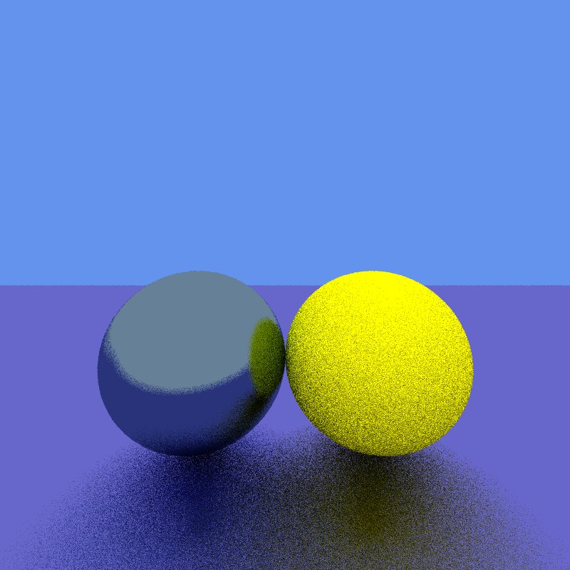

# Ray Tracer

[](https://github.com/SerbanUntu/ray-tracer/actions/workflows/build.yml)
[](https://serbanuntu.github.io/ray-tracer/)

A C++ ray tracing implementation featuring multiple rendering modes including traditional **Ray Tracing** and **Mandelbrot Set Generation**, verified with **metamorphic testing** across a matrix of compilers and optimization levels.

## Overview

This project implements a ray tracing engine capable of rendering 3D scenes with various materials and lighting effects. The implementation includes support for spheres, floors, and multiple material types including Lambertian diffuse surfaces, metallic reflections, dielectric materials for glass-like objects, and cubemap-textured surfaces. Additionally, the project includes a separate Mandelbrot set generator for mathematical visualization. The rendering phases for both the ray tracer and mandelbrot set generator run in parallel, with the maximum number of threads available on the device.

The ray tracer uses a recursive ray casting algorithm with configurable depth limits and supports multiple rays per pixel for anti-aliasing. The rendering pipeline processes scenes defined through a simple object-oriented interface and outputs BMP images.

---



*A metallic ball and a yellow Lambertian ball on a purple metallic surface*

---


*Mandelbrot visualisation centered at (0.16125, 0.63744) with 100x zoom. Uses smooth shading and periodic coloring.*

---

## Verification

### Metamorphic Testing

A renderer has no reliable expected output to test against, so instead of checking a single image, the test suite
checks how the image should change when the input is transformed: rotating or translating the scene together with the
camera, reordering objects, or stitching tiled Mandelbrot renders back together should all reproduce the original
render, either bit for bit or within a tolerance calibrated against the renderer's sampling noise. This approach caught
a real bug in the core tracing loop that made the image depend on the order of the scene's objects.
See [METAMORPHIC_TESTING.md](./METAMORPHIC_TESTING.md) for the invariants, the image similarity algorithm, and the results.

### Running the Tests

Tests are built alongside the project and registered with CTest. Run the full suite with:

```bash
ctest --test-dir cmake-build-release/build/Release --output-on-failure
```

Or run an individual test executable directly, e.g.:

```bash
./cmake-build-release/build/Release/common/test/raytracer-common-test.exe
./cmake-build-release/build/Release/mandelbrot/test/raytracer-mandelbrot-test.exe
./cmake-build-release/build/Release/raytracer/test/raytracer-raytracer-test.exe
```

### Continuous Integration

Every push runs the `build` GitHub Actions workflow:

- **Formatting**: `clang-format` checks every source file against the project's `.clang-format` style.
- **Build and test matrix**: the project is built and tested in 8 configurations, covering GCC and Clang, `-O0` and
  `-O3`, each with and without `-ffast-math`. The optimization level and fast-math mode are exposed as the CMake options
  `RAYTRACER_OPT_LEVEL` and `RAYTRACER_FAST_MATH`. Running the metamorphic tests in every configuration checks that
  compiler optimizations and relaxed floating-point semantics do not break the renderer's invariants.
- **Static analysis**: `clang-tidy` runs on one configuration (Clang, `-O3`) with all warnings treated as errors.

Dependencies are installed with Conan in every job, and the downloaded packages are cached between runs.

### Documentation

The API documentation is generated from the source comments with Doxygen and published to
[GitHub Pages](https://serbanuntu.github.io/ray-tracer/) by the `docs` workflow on every push to `main`. It can also be
generated locally with `doxygen` (or `just docs`), which writes the HTML output to `docs/html/`.

## Codebase

### Dependencies

- CMake 4.2 or higher
- C++23 compatible compiler
- [Conan](https://conan.io/) 2.x
- Google Test v1.17.0 (installed via Conan)
- nlohmann/json v3.12.0 (installed via Conan)
- Optional: [just](https://github.com/casey/just) for the recipes in the `Justfile`, and Doxygen with Graphviz for
  generating the documentation

### Project Structure

The code is split into three libraries (`common`, `raytracer`, `mandelbrot`) and an `apps`
directory that holds the executable entry points. Every library follows the same layout, with
public headers under `include/<name>/` and implementation under `src/`. All code is under the
`raytracer::` namespace (`raytracer::common`, `raytracer::raytracer`, `raytracer::mandelbrot`).

```
ray-tracer/
├── common/                          # Shared library (raytracer::common)
│   ├── include/common/
│   │   ├── util/
│   │   │   ├── vec3.h               # 3D vector mathematics
│   │   │   ├── point.h              # 2D point type
│   │   │   ├── complex.h            # Complex number operations
│   │   │   ├── random_utils.h       # Random number generation
│   │   │   └── terminal.h           # Terminal progress output
│   │   ├── image.h                  # BMP image generation
│   │   └── image_similarity.h       # Block-averaged image difference metric
│   ├── src/                         # Implementations for the above
│   └── test/
│       ├── util/test_vec3.cpp       # Unit tests for vector operations
│       └── test_image_similarity.cpp # Unit tests for the image difference metric
├── raytracer/                       # Ray tracing library (raytracer::raytracer)
│   ├── include/raytracer/
│   │   ├── materials/
│   │   │   ├── material.h           # Base material interface
│   │   │   ├── lambertian.h         # Diffuse materials
│   │   │   ├── lambertian_texture.h # Textured diffuse materials
│   │   │   ├── metal.h              # Metallic materials
│   │   │   ├── dielectric.h         # Glass and transparent materials
│   │   │   └── cubemap.h            # Cube-mapped textures
│   │   ├── shapes/
│   │   │   ├── object.h             # Base object interface
│   │   │   ├── sphere.h             # Sphere primitive
│   │   │   └── floor.h              # Floor plane implementation
│   │   ├── camera.h                 # Camera and ray generation
│   │   ├── renderer.h               # Multithreaded ray tracing renderer
│   │   └── scene.h                  # Scene management
│   ├── src/                         # Implementations for the above
│   ├── test/
│   │   └── test_renderer.cpp        # Metamorphic tests for the ray tracer
│   └── data/
│       └── texture.bmp              # Texture asset
├── mandelbrot/                      # Mandelbrot library (raytracer::mandelbrot)
│   ├── include/mandelbrot/
│   │   ├── renderer.h               # Multithreaded Mandelbrot renderer
│   │   └── scene.h                  # Mandelbrot scene configuration
│   ├── src/                         # Implementations for the above
│   └── test/
│       ├── test_json.cpp            # Config parsing tests
│       └── test_renderer.cpp        # Metamorphic tests for the Mandelbrot renderer
├── apps/
│   ├── raytracer.cpp                # Ray tracing executable entry point
│   └── mandelbrot.cpp               # Mandelbrot generator entry point
├── examples/
│   └── mandelbrot.json              # Mandelbrot configuration file
├── assets/                          # README images
│   ├── raytracer.bmp
│   └── mandelbrot.bmp
├── .github/workflows/
│   ├── build.yml                    # Format, build, lint and test matrix
│   └── docs.yml                     # Doxygen documentation deployment
├── CMakeLists.txt                   # Top-level build configuration
├── conanfile.txt                    # Conan dependencies
├── Doxyfile                         # Doxygen configuration
├── Justfile                         # Build, lint, test and CI recipes
└── METAMORPHIC_TESTING.md           # Metamorphic testing approach and results
```

#### Structure Descriptions

- **Materials System**: Implements various surface materials with different scattering behaviors. The base `Material` class provides reflection and refraction utilities, while derived classes implement specific material properties.
- **Shapes System**: Provides an abstract interface for geometric primitives. Currently supports spheres and floor planes, with extensible design for additional shapes.
- **Camera System**: Handles ray generation and camera positioning with configurable screen dimensions and sampling parameters.
- **Image Generation**: Implements BMP file output with support for various color depths and grayscale modes.
- **Image Similarity**: Compares two renders by averaging the colour over square blocks and measuring the mean distance between them, which filters out sampling noise while keeping structural differences.

### Architecture

The ray tracer follows a modular architecture with separation between geometric primitives, materials, and rendering logic. The main rendering loop lives in the library's `Renderer` class. It iterates through screen pixels, generates multiple rays per pixel for antialiasing, and traces each ray through the scene using recursive ray casting, shading only the nearest intersection of each ray. This loop is run over multiple parallel threads.

The material system uses polymorphism to handle different surface interactions, with each material implementing its own scattering function. The shapes system provides a unified interface for intersection testing and normal calculation across different geometric primitives.

## Usage

### Building the Project

Dependencies are installed with Conan, which also generates the `conan-release` CMake preset.
On Windows, run these from a Visual Studio developer shell:

```bash
conan profile detect --force
conan install . --build=missing --output-folder=cmake-build-release
cmake --preset conan-release
cmake --build --preset conan-release
```

Build output is placed under `cmake-build-release/build/Release/`. `just check` runs the same
format, build, lint and test steps as the CI workflow.

### Running the Ray Tracer

The ray tracer executable generates a scene with three spheres and a floor:

```bash
./cmake-build-release/build/Release/apps/raytracer.exe
```

This will output a BMP file named `raytracer.bmp` in the build directory. The scene includes:
- A yellow diffuse (Lambertian) sphere
- A metallic sphere
- A large cubemap-textured sphere in the background
- A reflective metallic floor plane

### Running the Mandelbrot Generator

The Mandelbrot set generator creates mathematical visualizations:

```bash
./cmake-build-release/build/Release/apps/mandelbrot.exe
```

This generates `mandelbrot.bmp` with a high-resolution view of the Mandelbrot set using a custom
16-color palette and smooth (normalized iteration count) shading. The generator reads configuration parameters from `examples/mandelbrot.json`, allowing you to customize the center point, zoom level, resolution, and other rendering parameters without recompiling.

### Configuration

**Mandelbrot Generator**: Parameters are configured via `examples/mandelbrot.json`:
- `center`: `{ "x", "y" }` coordinates of the center point on the complex plane
- `zoom`: Magnification level
- `width`: Output image width in pixels (height is derived from `aspect_ratio`)
- `aspect_ratio`: Image aspect ratio
- `max_iterations`: Maximum iteration count for convergence testing
- `escape_boundary_squared`: Squared escape radius for divergence detection
- `output_path`: Output file path

**Ray Tracer**: Key parameters can be modified directly in `apps/raytracer.cpp`:
- **Camera settings**: Screen resolution, rays per pixel, recursion depth, view type
- **Scene objects**: Position, size, and material properties
- **Rendering effects**: Background/sky colors, shading thresholds, grayscale mode
